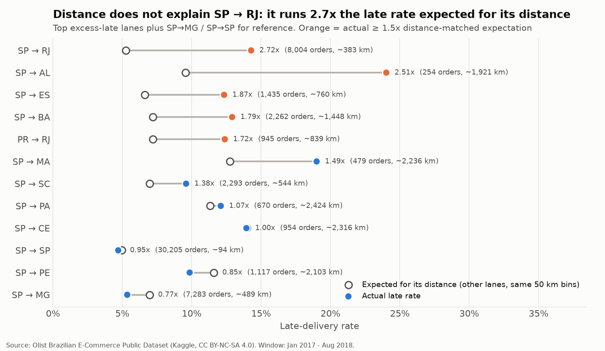
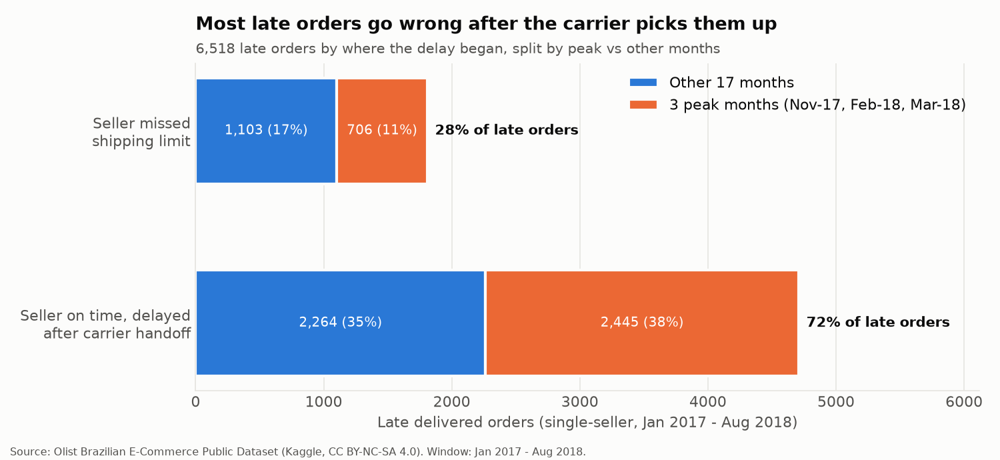
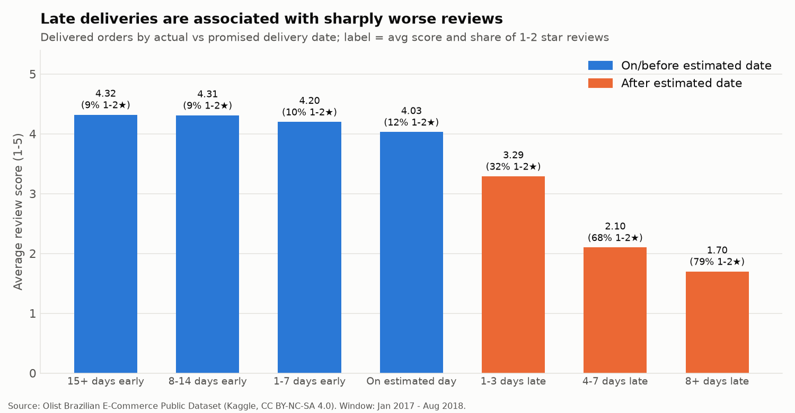
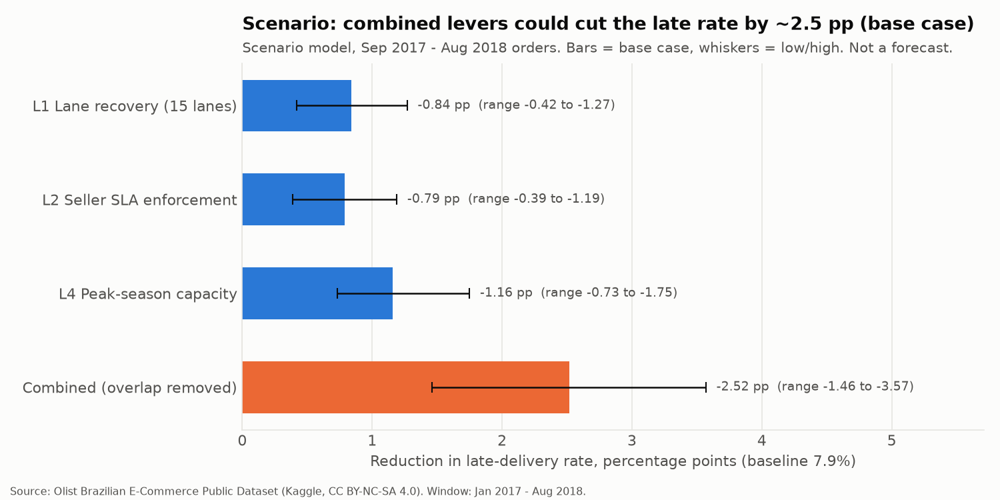
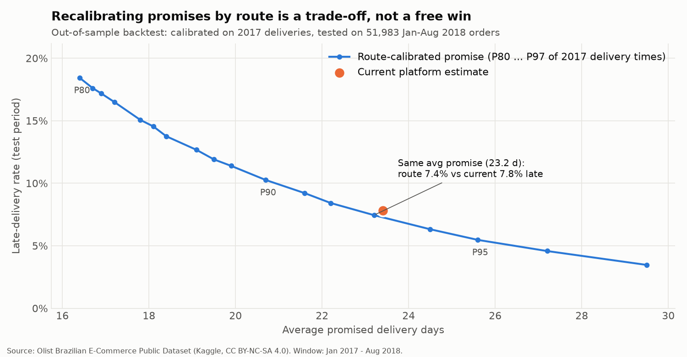
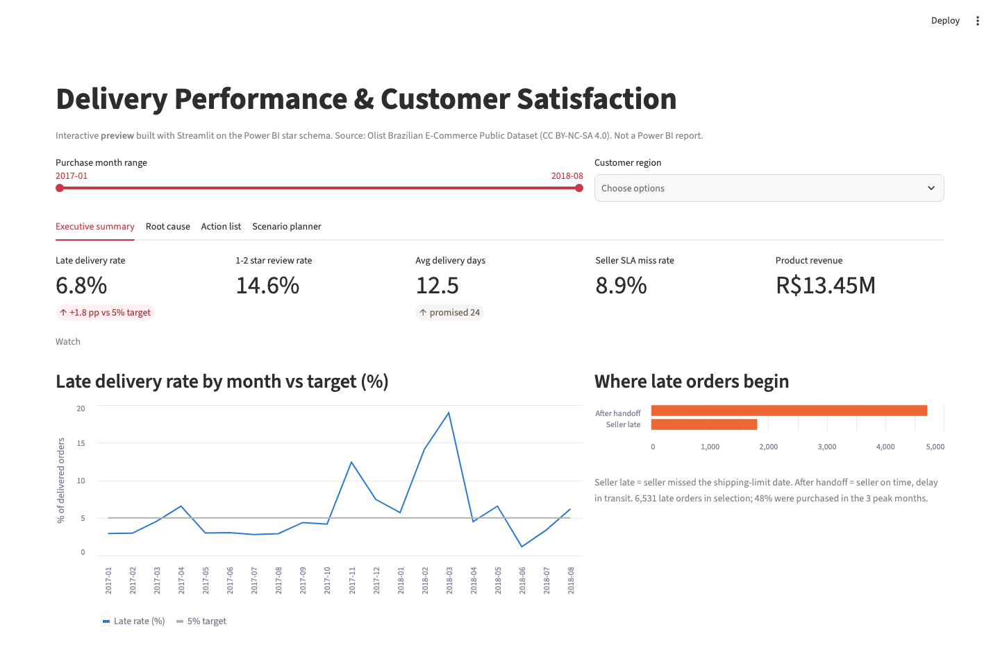
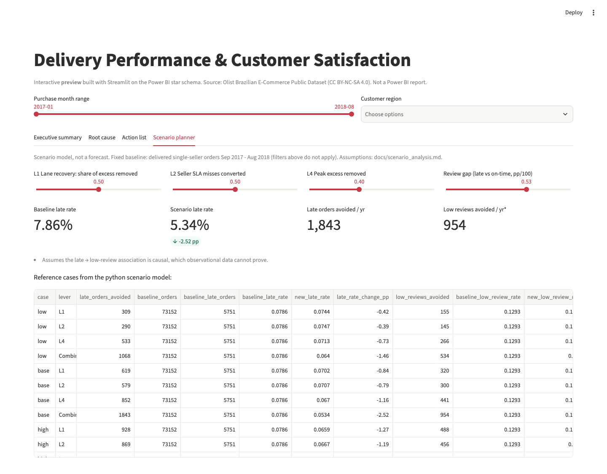

# Fixing Late Deliveries: an Operations Prioritisation Case Study

**Which operational improvements should an e-commerce marketplace fund first to reduce delivery delays and improve customer satisfaction?**

A business analysis case study on the public [Olist Brazilian E-Commerce dataset](https://www.kaggle.com/datasets/olistbr/brazilian-ecommerce) (99,441 orders, 9 related tables, 2016–2018). It is framed as a consulting engagement for a hypothetical VP of Operations. It runs from problem framing and requirements to root-cause analysis, a transparent scenario model, a Power BI dashboard and an executive recommendation. Every number is produced by a tested, reproducible SQL + Python pipeline.

> **Scope note.** The data is real. The sponsor, stakeholders, targets and roadmap are **hypothetical**, constructed to show how a BA would run the engagement. No interventions were implemented, and no stakeholder interviews took place.

---

## The answer
| | |
|---|---|
| **Problem** | 6.8% of delivered orders miss the delivery date promised at checkout. Late orders get 1–2 star reviews **62%** of the time, against **9%** when on time. 97% of customers buy only once, so reviews are what new buyers see. |
| **Root cause** | **72%** of late orders were handed to the carrier on time; the delay happens in transit. It is concentrated: **15 lanes = 88%** of excess late orders on 22% of volume, and **3 months = 48%** of late orders. |
| **Sharpest finding** | **São Paulo → Rio de Janeiro** runs **14.3%** late against **5.25%** expected for its distance (2.7×), in both 2017 and 2018. It is badly served, not just far away. |
| **Recommendation** | 1. Lane recovery pilot (SP→RJ, SP→ES first, with control lanes). 2. Peak-season playbook. 3. Seller deadline alerts for 57 sellers (quick win). Enablers: carrier ID capture and a weekly KPI review. |
| **Deprioritised (tested)** | Lengthening delivery promises: out of sample it barely helps at equal promise length (7.83% → 7.45%). |
| **Scenario (not a forecast)** | Late rate 7.9% → **5.3%** at base assumptions (range 6.4% to 4.3%; 6.1% if only the November peak is addressable). Staged target: ≤ 6%, then ≤ 5%. **No ROI claimed**: the dataset has no cost data. |

→ **Read the 1-page [executive memo](reports/executive_memo.md)** · [Executive summary](reports/executive_summary.md)

<p align="center"></p>

<table>
<tr>
<td></td>
<td></td>
</tr>
<tr>
<td></td>
<td></td>
</tr>
</table>

---

## Power BI dashboard
)

The Executive Overview page uses the star schema and DAX measures from the [Power BI build package](dashboard/powerbi/README.md). Its KPI cards match the validated SQL scorecard ([`q01_kpi_scorecard.csv`](outputs/sql/analysis/q01_kpi_scorecard.csv)): 97,910 orders, 13.45M product revenue (Brazilian reais), 93.2% on-time, 12.5 average delivery days.

The `.pbix` report file is **not published in this repository yet**: it embeds an imported copy of the data, which is under review against the dataset licence. The build package (Power Query, DAX, model, page spec) is included so the report can be rebuilt from the pipeline outputs.

**Interactive preview (Streamlit, not Power BI):** built on the same star schema and tested to reproduce the validated KPIs. Run it with `make preview`.

<table>
<tr><td></td>
<td></td></tr>
</table>

## How the analysis was built
| Stage | What it does | Where |
|---|---|---|
| **Data** | Downloads the 9 Olist CSVs and records a SHA-256 manifest | [`python/olist_ba/ingest.py`](python/olist_ba/ingest.py), [`data/README.md`](data/README.md) |
| **SQL (DuckDB)** | Two-layer schema (raw `stg` → typed `dw`), 8 validation suites (31 PASS / 9 INFO checks), 20 named business queries; T-SQL port for SQL Server | [`sql/`](sql/README.md), results in [`outputs/sql/`](outputs/sql/) |
| **Python** | pandas cleaning and KPIs (reconciled against SQL), statistics, root-cause decomposition, scenario model, charts, Power BI export, run end to end by [`pipeline.py`](python/olist_ba/pipeline.py) | [`python/olist_ba/`](python/olist_ba/), results in [`outputs/`](outputs/) |
| **Notebook** | Executed walkthrough of the evidence behind each finding | [`python/notebooks/analysis.ipynb`](python/notebooks/analysis.ipynb) |
| **Dashboard** | Power BI report (screenshot above) and Streamlit preview | [`dashboard/`](dashboard/), [`screenshots/`](screenshots/) |
| **Tests** | Unit, SQL-vs-pandas reconciliation, scenario/DAX parity, BI schema, README-number and link checks | [`tests/`](tests/) |

## How to navigate this repo
| If you have… | Read |
|---|---|
| **2 minutes** | This page and the [executive memo](reports/executive_memo.md) |
| **10 minutes** | [Insights & evidence grading](docs/06_insights_and_evidence.md) → [Recommendations (impact vs. effort)](docs/09_recommendations.md) → [Scenario analysis](docs/08_scenario_analysis.md) |
| **Business analysis depth** | [Charter](docs/01_project_charter.md) · [Stakeholders](docs/02_stakeholder_analysis.md) · [BRD](docs/03_business_requirements.md) · [Process improvement (current/future state)](docs/07_process_improvement_proposal.md) · [Roadmap](docs/10_implementation_roadmap.md) · [Risk register](docs/11_risk_register.md) |
| **Technical depth** | [Analysis notebook](python/notebooks/analysis.ipynb) · [SQL (20 queries + validation)](sql/README.md) · [Python package](python/olist_ba/) · [Tests](tests/) · [Power BI package](dashboard/powerbi/README.md) |
| **Interview prep** | [Interview walkthrough](docs/12_interview_walkthrough.md) · [Hiring-manager self-review](docs/13_hiring_manager_review.md) · [Project audit](docs/14_project_audit.md) |

## What makes the analysis trustworthy
- **Two independent implementations.** Cleaning and KPIs are built in SQL (DuckDB) *and* in pandas. Tests prove the two are identical across all 29 order-level columns and every headline KPI.
- **Validation before insight.** 31 checks (row counts, PK/FK integrity, cent-level revenue reconciliation, business rules) must pass, or the build fails.
- **Correlation vs. causation, made explicit.** Every finding carries an evidence grade. The lateness → bad-review link is tested raw, within the same seller, and with a seller-clustered logistic regression, plus dose-response. It is reported as a *robust association*, not proven causation.
- **Bias checks.** Distance standardisation (is the lane far or badly served?), year-over-year persistence (selection bias), a hindsight check on peak months, and an out-of-sample backtest.
- **Honest limits.** No cost data means no ROI. No carrier ID means no carrier attribution. The data is from 2016–18. See [the self-review](docs/13_hiring_manager_review.md).

## Quick start
Requirements: Python 3.11+ (tested on 3.13.1), `make`, about 1.5 GB of free disk.
```bash
git clone <this-repo> && cd <this-repo>
make setup        # venv + pinned dependencies + notebook kernel
make all          # download data → SQL build/validation/analysis → stats → root cause → scenarios
                  #   → charts → BI export → notebook → tests   (~2 min after download)
make preview      # optional: interactive dashboard at http://localhost:8501
```
Individual steps: `make data`, `make pipeline`, `make notebook`, `make test`. Without `make`, run the commands listed in the [Makefile](Makefile).

## Tech stack
| Layer | Tools |
|---|---|
| Data & SQL | DuckDB 2.0 (tested engine), SQL Server 2022 T-SQL port via sqlglot ([status](sql/tsql/README.md)) |
| Analysis | Python 3.13, pandas, NumPy, SciPy, statsmodels |
| Visualisation | matplotlib (static, validated colour palette), Streamlit (preview) |
| BI | Power BI: star schema, Power Query M, DAX measures |
| Quality | pytest (unit + integration + link checks), deterministic SQL, pinned dependencies |

## Repository structure
```
├── README.md                  ← you are here
├── LICENSE                    MIT (code and documentation)
├── Makefile                   setup / data / pipeline / notebook / test / preview
├── requirements.txt           pinned dependencies
├── reports/                   executive memo & summary
├── docs/                      charter, stakeholders, BRD, cleaning log, KPI dictionary, insights,
│                              process proposal, scenario, recommendations, roadmap, risks, interview guide
├── sql/                       schema.sql, load.sql, validation.sql, analysis.sql, data dictionary, tsql/
├── python/olist_ba/           ingest, clean, kpis, stats, root_cause, scenarios, charts, export_bi, pipeline
├── python/notebooks/          analysis.ipynb (executed) + builder script
├── dashboard/powerbi/         Power BI build package     dashboard/streamlit/  preview app
├── tests/                     unit, reconciliation, scenario/DAX parity, BI schema, link checks
├── outputs/                   committed query results, stats, root-cause and scenario outputs, key_metrics.json
├── assets/                    charts/ (17 PNGs), dashboard/ (Streamlit preview screenshots)
├── data/                      README with source & download; raw/processed/bi are git-ignored
└── screenshots/               Power BI dashboard screenshot
```

## Appendix: commercial context charts
These are not central to the decision, but they show revenue context: [revenue trend](assets/charts/01_monthly_revenue_trend.png) · [YoY deceleration](assets/charts/02_yoy_growth_deceleration.png) · [category Pareto](assets/charts/03_category_pareto.png) · [seller concentration](assets/charts/08_seller_concentration.png) · [customer frequency](assets/charts/09_customer_frequency.png) · [freight burden](assets/charts/11_freight_burden.png) · [instalments](assets/charts/12_installments_vs_aov.png).

## Data & licence
- **Data:** [Olist Brazilian E-Commerce Public Dataset](https://www.kaggle.com/datasets/olistbr/brazilian-ecommerce), **CC BY-NC-SA 4.0**. It is not redistributed here; it is downloaded by `make data` (see [data/README.md](data/README.md)).
- **Code and documentation:** [MIT](LICENSE).
- **Derived charts and outputs:** shared under CC BY-NC-SA 4.0, with attribution to Olist.
