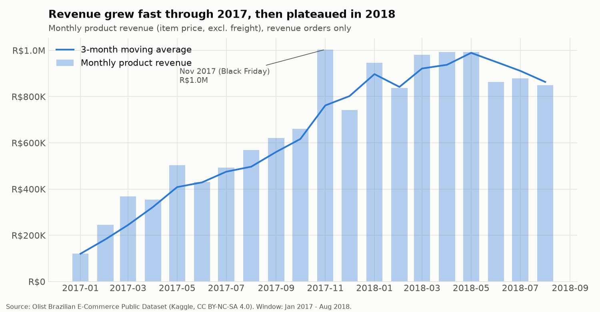
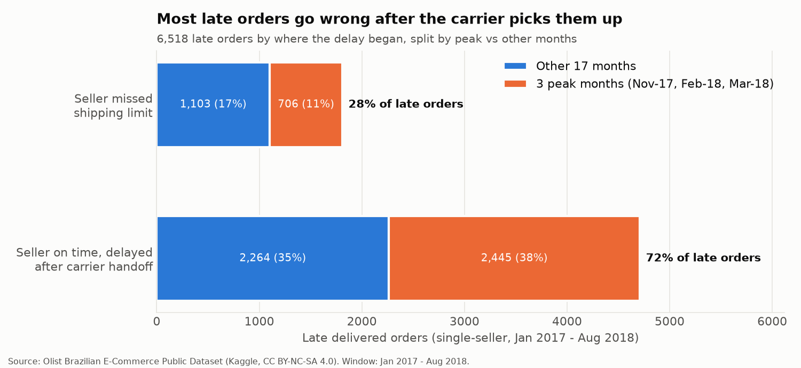
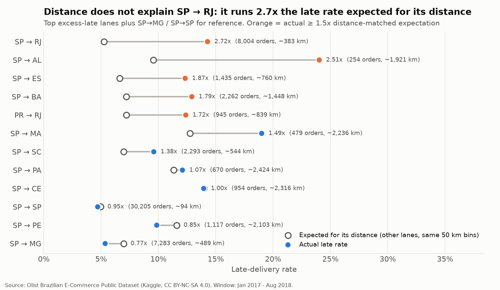
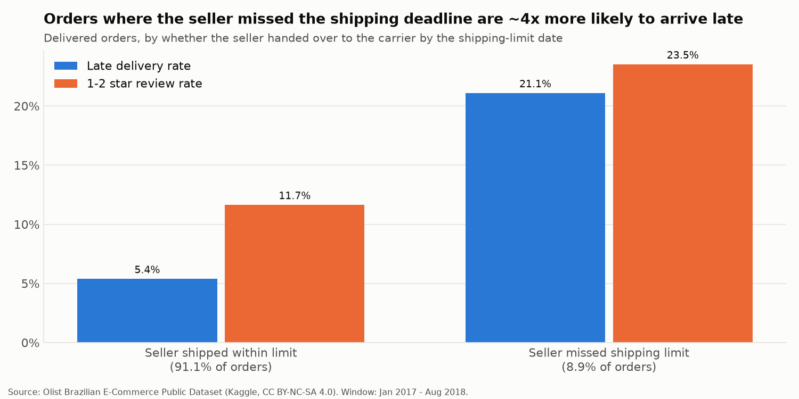
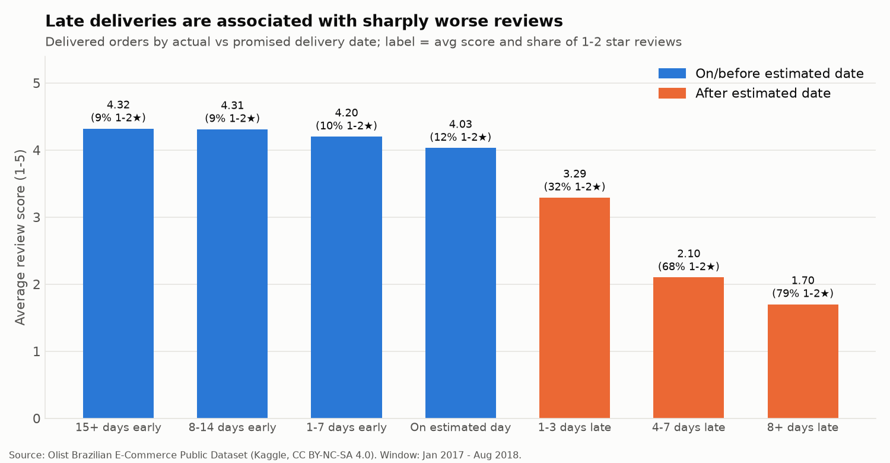
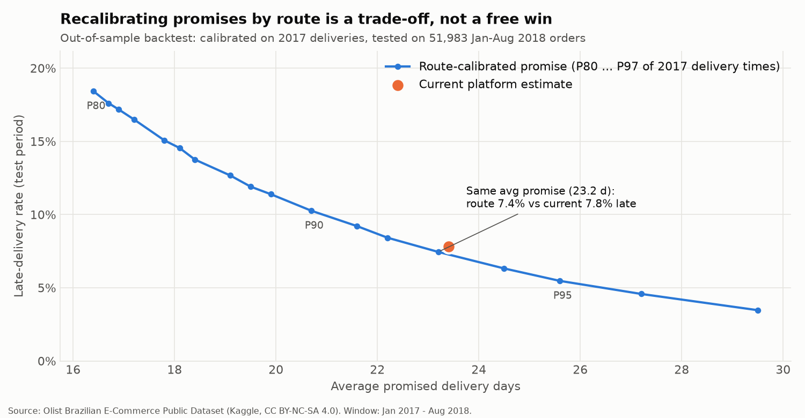

# Insights & evidence grading

Every finding below is reproducible from the pipeline. Sources are given as `query/file`. Numbers are also collected in `outputs/key_metrics.json`.

## Evidence grades used
| Grade | Meaning | What it licenses |
|---|---|---|
| **Observed** | A descriptive fact about the complete population of orders in the window | "X happened" |
| **Robust association** | The relationship holds under several independent controls and shows dose-response | "X is strongly linked to Y; a causal effect is plausible but unproven" |
| **Association** | A relationship that is not controlled for obvious confounders | "X co-occurs with Y" |
| **Hypothesis** | A plausible explanation or intervention effect that this data cannot test | "Test this" |

---

## F1. About 1 in 15 delivered orders breaks the delivery promise. Customers rarely return, so reviews carry the reputation. *(Observed)*
- **6.79%** of delivered orders (6,531 of 96,203) arrived after the promised date. The average delivery took **12.5 days** against an average promise of **24.3 days**. Promises are generous on average, but they still fail for some orders. *(q01)*
- **97.0%** of customers placed only one order in 20 months. *(q12)*
- Revenue growth slowed sharply: Jan–Aug 2018 revenue was +138% year on year, but monthly year-on-year growth fell from +687% (January) to +49% (August), and monthly revenue was flat at about R$0.85–0.99M through 2018. *(q02, q03)*
- **So what:** growth increasingly depends on converting *new* buyers, and new buyers see reviews. Delivery reliability is therefore a commercial issue, not only an operational one.

## F2. 72% of late orders were handed to the carrier on time; the delay happened afterwards. *(Observed)*
- Of 6,518 late single-seller orders, **72.3%** had a seller handoff within the shipping-limit date. Only **27.7%** began with a seller missing the deadline. *(root_cause/late_decomposition.csv)*
- Median stage times: approval **0.34 h**, approval → carrier **1.84 days**, carrier → customer **7.12 days**. *(q08 and the cleaning log; dq-flagged orders excluded)*
- The monthly late-rate spikes coincide with carrier transit time, not seller handoff. Median carrier → customer days peaked at 11.0 in Feb 2018, against roughly 7 in normal months. Approval → carrier stayed between about 1.2 and 2.7 days throughout. *(q08)*
- **So what:** the largest lever sits with Logistics and carriers, not sellers. **Limitation:** the data has no carrier identifier, so "post-handoff" cannot be split by carrier (data requirement DR-1).

## F3. Late deliveries are concentrated in a few lanes. SP→RJ is anomalous even after allowing for distance. *(Observed; the distance comparison is a standardised comparison)*
- The **15 worst lanes** (seller state → customer state) account for **87.6%** of all excess late orders but only **21.8%** of delivered volume. *(root_cause/top_routes_excess_late.csv)*
- **SP→RJ** alone: 8,031 orders, **14.3%** late (SP→SP: 4.7%), 596 excess late orders. Distance does not explain it: other lanes at the same distances run **5.25%** late, so SP→RJ is **2.7×** its distance-matched expectation. SP→MG, a comparable high-volume lane, performs *better* than its expectation (0.77×). *(root_cause/lane_distance_matched.csv)*
- Both lanes *into* Rio de Janeiro underperform (SP→RJ 2.7×, PR→RJ 1.7×). Long-haul lanes such as SP→CE (1.0×) and SP→PA (1.07×) perform as expected for their distance.
- Rio de Janeiro customers generate **13.4%** of revenue, but 12.1% of their deliveries are late versus 4.5% for São Paulo (χ² p < 10⁻²⁰⁰). *(stats_summary.json)*
- **Not regression to the mean:** lanes were selected *because* they were bad, so I checked persistence. Lane late rates in 2017 predict 2018 (Spearman ρ = 0.68, 78 lanes), and all 10 of 2017's worst lanes stayed above the platform rate in 2018. SP→RJ ran 2.2× the platform rate in 2017 and 2.0× in 2018. *(root_cause/lane_persistence.csv)*
- **So what:** a targeted lane programme can reach most of the problem while touching a minority of volume. Two lane types need different responses. *Anomalous* lanes (RJ, ES, BA, AL) need carrier/last-mile performance management. *Distance-explained* long-haul lanes are already being promised appropriately.
- **Hypothesis (untested):** a last-mile issue specific to Rio de Janeiro. The data cannot distinguish carrier, hub or local delivery conditions.

## F4. Three months produced almost half of all late orders. *(Observed)*
- Nov 2017, Feb 2018 and Mar 2018 are 3 of the 20 months, but produced **48.3%** of late orders. Late rates in those months were 12.4%, 14.2% and 19.0%, against roughly 3–7% in most other months. *(late_decomposition.csv, q08)*
- November coincides with Black Friday, the highest-volume month (7,423 revenue orders). Feb–Mar 2018 volume was no higher than January's (6,625 and 7,168 orders, against 7,187), when the late rate was 5.7%. Volume alone therefore does not explain that spike. **Its cause is not identifiable from this data** and is a discovery question for Logistics.
- **So what:** a peak-season playbook (carrier capacity commitments, earlier seller cut-offs, temporary promise buffers) addresses a large, predictable share of the problem.

## F5. Seller deadline misses are a smaller driver, concentrated in a few sellers. *(Association)*
- 8.9% of delivered orders were handed over after the shipping limit. Those orders were late **21.1%** of the time, against **5.4%** for on-time handoffs (about 4×). *(q09)*
- **77%** of SLA misses come from the top 10% of sellers by miss count. **57 sellers** meet the "Intervene" rule (SLA miss > 15% and late > 10%, at least 30 orders); together they handle 5.5% of delivered orders. *(root_cause_summary.json, dim_seller)*
- **Grade rationale:** sellers who miss deadlines may also differ in other ways, such as location or product type. The mechanism is direct, though: a later handoff leaves less buffer before the promised date.

## F6. Late delivery is strongly and robustly linked to 1–2 star reviews. *(Robust association)*
| Comparison | Gap in 1–2 star rate, late vs. on time |
|---|---|
| Raw | **53.7 pp** (62.4% vs. 8.7%) |
| Within the same seller (1,201 sellers with both) | **52.9 pp** |
| Logistic regression, controlling for price, freight ratio, basket size, interstate shipping, customer state, top-30 category and month; standard errors clustered by seller | **51.1 pp** average marginal effect (95% CI 49.6–52.5); odds ratio 17.2 |

- **Dose-response:** the 1–2 star rate is 32% for orders 1–3 days late, 68% for 4–7 days late and 80% for 8–14 days late. *(root_cause_summary.json)*
- **Why this is not proof:** the comparisons control for stable seller traits and the observed order characteristics, but not unobserved order-level factors that may travel with lateness (for example, transit damage or lost-then-found parcels). Reverse causation is implausible, because the review follows delivery.
- **So what:** fixing lateness is very likely to reduce bad reviews. The *size* of the effect should be confirmed by a controlled pilot before it is used in financial planning.

## F7. Changing the promise is not a substitute for improving delivery. *(Observed, out-of-sample backtest)*
- Route-calibrated promises were set on 2017 deliveries and tested on 51,983 Jan–Aug 2018 orders. They form a trade-off curve, and **the current estimate already lies on it**. At an equal average promise (23.2 vs. 23.4 days), the route-based policy gives a 7.45% late rate against 7.83% today. That is an improvement of under half a point.
- Cutting the late rate to about 5.5% by promises alone would mean promising about 2 days longer on average, with an unknown effect on conversion (data requirement DR-4).
- **So what:** recalibrating promises is deprioritised. A temporary peak-season buffer remains a reasonable tactical option.

## F8. The link to repeat purchases is real but small. *(Association; statistically significant)*
- Customers whose first order was late reordered at **2.74%**, against **3.55%** when it was on time (χ² p = 0.0016). That is about 46 fewer repeat customers over the period. *(stats_summary.json)*
- **So what:** retention is low regardless of delivery. The business case for delivery improvement rests on reviews and reputation, not on repeat revenue. Claiming a large retention or revenue uplift would be unsupported.

## Context findings (commercial, not core to the decision)
- 17 of 74 categories generate about 80% of revenue. Health & beauty and watches & gifts led growth in 2018. *(q04, q05)*
- The top 10% of sellers generate 67% of revenue *(q10)*. Seller programmes must be designed so they do not alienate high-value sellers. Several top-revenue sellers have elevated SLA-miss rates *(q11)*.
- On orders under R$50, freight adds about 48% to the item price *(q18)*.
- Orders paid in 7 or more instalments average R$302, against R$100 for single payments, and carry 27% of revenue *(q17)*.

## What this analysis does **not** show
- Any profit, cost saving or ROI. The dataset has no cost or margin data.
- Which carrier is responsible for any lane.
- The cause of the Feb–Mar 2018 deterioration.
- The causal effect of any intervention. Every intervention effect is a scenario assumption (`08_scenario_analysis.md`).
