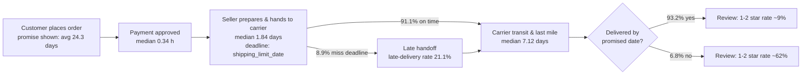
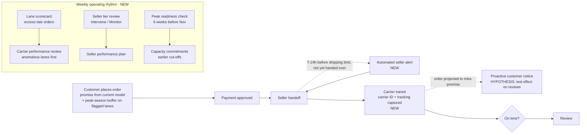

# Process improvement proposal: order fulfilment & delivery-promise management

> The **current-state** map is reconstructed from the timestamps in the data, and its durations are measured. The **future-state** map is a **proposed design** (a business scenario). None of it has been implemented or validated with Olist. Control points that do not exist in the data, such as alerts and reviews, are proposals.

## 1. Current state (as evidenced by the data)

**Pain points (with evidence):**
| # | Pain point | Evidence | Owner today (assumed) |
|---|---|---|---|
| P1 | No lane-level visibility of carrier performance; post-handoff delay is the main source of lateness | 72% of late orders were handed over on time; top 15 lanes = 88% of excess late (F2, F3) | Logistics |
| P2 | Peak periods overwhelm transit capacity | 3 months = 48% of late orders (F4) | Logistics |
| P3 | Shipping-limit deadline missed with no visible intervention | 8.9% of handoffs late; 77% of misses from 10% of sellers (F5) | Seller Success |
| P4 | No shared KPI on promise reliability; customer impact is not tied to operational metrics | Lateness → 1–2 star gap of 51–54 pp (F6) | No single owner |
| P5 | Carrier is not recorded per order, so root cause after handoff cannot be determined | Data requirement DR-1 | Logistics / Data |

## 2. Future state (proposed)

## 3. Changes, rationale and measures
| Change | Addresses | Expected effect (scenario, not a forecast) | Measure of success |
|---|---|---|---|
| C1. Lane scorecard plus carrier performance reviews, starting with SP→RJ, PR→RJ, SP→ES, SP→BA, SP→AL | P1 | L1 base: −0.84 pp platform late rate | Lane late rate vs. distance-matched expectation |
| C2. Peak-season readiness: capacity commitments, earlier seller cut-offs, temporary promise buffer on flagged lanes | P2 | L4 base: −1.16 pp | Peak-month late rate ≤ 10% |
| C3. Seller deadline alerts plus a tiered performance plan for the 57 "Intervene" sellers | P3 | L2 base: −0.79 pp | Seller SLA miss rate ≤ 6% |
| C4. Weekly operating review on one dashboard, with a single owner for promise reliability | P4 | Enabler | Review held weekly; actions logged |
| C5. Capture carrier ID and tracking events | P5 | Enabler for C1 | % of orders with carrier ID = 100% |
| C6. Proactive delay notification | P4 | **Hypothesis only.** No data supports an effect. | A/B test: 1–2 star rate among late orders |

Combined C1 + C2 + C3, with overlap removed: −2.52 pp (range −1.46 to −3.57). See `08_scenario_analysis.md`.

## 4. What deliberately does not change
- **The promise algorithm.** The backtest shows little gain at equal promise length (F7). Change it only for peak buffers.
- **Seller onboarding and catalogue.** These are out of scope, and the data shows no link to delivery performance.

## 5. Process KPIs (operational definitions in `05_kpi_dictionary.md`)
- Lane: late rate, excess late orders, ratio to the distance-matched expectation.
- Seller: SLA miss rate, late rate, tier.
- Platform: late rate (primary), 1–2 star rate, average promised days (guardrail).
