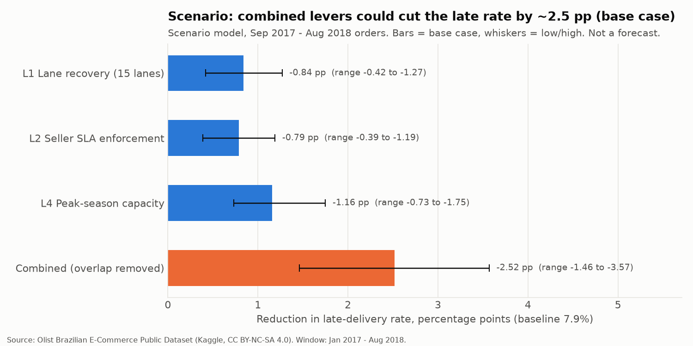

# Scenario analysis: potential impact of the proposed interventions

> **This is a scenario model, not a forecast.** It answers: *if* each intervention removed a stated share of the problem it targets, what would happen to late deliveries and low reviews? The assumptions are judgement calls, shown openly so a sponsor can challenge them. Code: `python/olist_ba/scenarios.py`. The same logic is in the dashboard's scenario page (`measures.dax`, Folder 4), and the two are tested for equality.

## 1. Baseline
- **Population:** delivered single-seller orders purchased **Sep 2017 – Aug 2018**, one observed year: **73,152** orders, **5,751** late (**7.86%**).
- The baseline-year late rate is higher than the full-window 6.79% because all three peak months fall inside it.
- 1–2 star review rate in the baseline year: **12.93%**.

## 2. Method
1. **Attributable share.** Each lever acts only on the part of its segment's late rate that is above a benchmark. For example, SP→RJ in the baseline year ran 17.8% late against a 7.9% platform rate, so (17.8 − 7.9) / 17.8 ≈ 56% of its late orders are "excess". Only that excess is addressable by L1.
2. **Per-order prevention probability** = assumption × attributable share.
3. **Overlap removal.** An order touched by several levers is prevented with probability 1 − Π(1 − pᵢ). Levers are never simply summed.
4. **Satisfaction translation.** Late orders avoided × share of late orders with a review (99%) × review gap. The review gap comes from F6: low = 51.1 pp (regression), base = 52.9 pp (within-seller), high = 53.7 pp (raw). **This step assumes the association is causal.**

| Lever | Segment | Benchmark | Attributable share |
|---|---|---|---|
| L1 Lane recovery | 15 lanes with the most excess late orders | Platform late rate (7.9%) | Lane-specific: (lane rate − 7.9%) / lane rate |
| L2 Seller SLA enforcement | Orders whose seller missed the shipping limit | Late rate of on-time handoffs (6.3%) | (23.6 − 6.3) / 23.6 = 73% |
| L4 Peak-season capacity | Orders in Nov-17, Feb-18, Mar-18 | Late rate of other months (4.95%) | (15.3 − 4.95) / 15.3 = 68% |

## 3. Assumptions (share of the addressable excess removed)
| Assumption | Low | Base | High | Basis |
|---|---|---|---|---|
| L1: lane excess removed | 25% | 50% | 75% | Judgement. Carrier changes on a lane can be large, but the lane anomaly's cause is unknown (F3). |
| L2: seller misses converted to on-time | 25% | 50% | 75% | Judgement. Alerts plus performance plans; 77% of misses come from 10% of sellers, a tractable group. |
| L4: peak excess removed | 25% | 40% | 60% | Judgement. Capped lower because part of the peak excess (Feb–Mar 2018) has no known cause. |

## 4. Results (baseline year)
| Lever | Late orders avoided (base) | Late-rate change, base [low, high] |
|---|---|---|
| L1 Lane recovery | 619 | −0.84 pp [−0.42, −1.27] |
| L2 Seller SLA | 579 | −0.79 pp [−0.39, −1.19] |
| L4 Peak capacity | 852 | −1.16 pp [−0.73, −1.75] |
| **Combined (overlap removed)** | **1,843** | **−2.52 pp [−1.46, −3.57]** |

| Outcome | Baseline | Low | **Base** | High |
|---|---|---|---|---|
| Late delivery rate | 7.86% | 6.40% | **5.34%** | 4.29% |
| 1–2 star review rate* | 12.93% | 12.20% | **11.62%** | 11.04% |
| Low reviews avoided per year* | — | 534 | **954** | 1,375 |

\* Assumes the late → low-review association is causal.

### Sensitivity
If all three assumptions move together, the combined late rate is 7.26% at 10%, 6.13% at 30%, 5.11% at 50%, and 4.19% at 70% (`outputs/scenarios/sensitivity.csv`). **A 5% target needs roughly 50–55% execution on every lever.** That is why the charter stages the target (≤ 6% at 2 quarters, ≤ 5% at 12 months).

### Robustness: peak months were chosen with hindsight
The three peak months were identified *because* they were bad, which flatters L4. Only November (Black Friday) is predictable. Re-running with L4 acting on **November only**, the combined late rate becomes **6.95% / 6.13% / 5.34%** (low / base / high). If the Feb–Mar 2018 spike does not recur and cannot be planned for, the realistic base case is about 6.1%. The first-stage target (≤ 6%) then needs slightly better than base execution, and the 5% target becomes a stretch. (`outputs/scenarios/scenario_variant_november_only.csv`)

### L3: promise recalibration, reported separately
Changing promises changes what counts as "late" without changing the delivery, so it is not added to the operational total. In the out-of-sample backtest, at an equal average promise the late rate falls only from 7.83% to 7.45%. It is deprioritised (F7).

## 5. What the model does not include
- **Money.** No cost, margin, refund or lifetime-value data is available. The model therefore produces operational and customer outcomes only. Converting them to money needs Finance inputs (data requirement DR-3).
- **Second-order effects:** conversion changes from different promises, seller churn from stricter SLAs, carrier price changes.
- **Uncertainty in the shares themselves.** The attributable shares are point estimates from one year. A pilot measurement should replace the assumptions as soon as it exists.

## 6. How to validate (pilot design)
Run L1 as a **staggered lane rollout**. Apply the carrier intervention to SP→RJ and SP→ES first, and use comparable lanes (for example PR→RJ and SP→BA) as controls until they join. Estimate the effect with a **difference-in-differences** on the lane late rate, and replace the L1 assumption with the measured effect. **Sample size.** SP→RJ carried about 507 delivered orders a month in the baseline year. About 1,030 orders per period (roughly 2 months) gives 80% power to detect a 4-point drop from a 14% late rate in a simple two-proportion comparison (α = 0.05, `statsmodels` NormalIndPower). A difference-in-differences design with control lanes needs more data. Plan **3–4 months** per phase, and avoid letting a phase straddle a peak month (Nov, Feb–Mar), which would confound the comparison.
